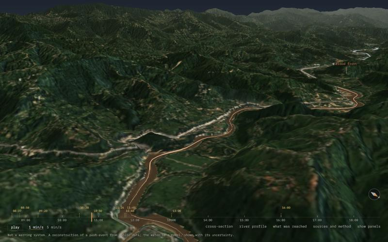
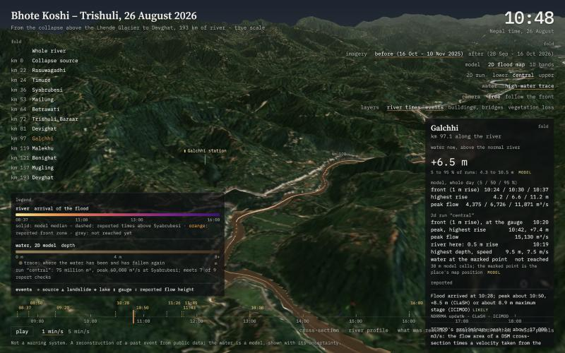

# Himalayan Valley Floods

A scientific reconstruction of the 26 August 2026 flood on the Bhote Koshi and Trishuli rivers in Nepal. It is an
interactive 3D browser app built from open data and published reports.

**Open the app: https://himalayan-valley-floods.0xbyt4.workers.dev/**



**This is not a warning system and not an official hazard map.** It reconstructs a past event. The water in it is
a model, and the app shows every model result with its uncertainty. People died and are missing in this flood. The
app and this repository use calm, factual language.

## What the app shows

- The valley from the collapse source above the Lhende Glacier to Devghat, 193 km of river, at true scale. The
  terrain is the Copernicus DEM (30 m). The imagery is Sentinel-2 from before and after the flood.
- A 2-D flood map. A shallow-water model shows where the water spreads, through side valleys, flats and towns,
  every 3 minutes. Three runs are available: lower, central and upper.
- 1-D bands. A flood-routing model gives the rise of the water at each river section as a 5, 50 and 95 % band.
- Reported events, each with its sources and a confidence grade: SOLID, LIKELY, UNCERTAIN or DISPUTED.
- Buildings, bridges, roads and facilities from OpenStreetMap, each with the band that reached it.
- Vegetation loss on the valley floor, from Sentinel-2 NDVI before and after the flood.
- A river profile, a cross-section, a compass and a timeline.
- A guided tour of eight steps, and a "How sure is this?" section with each model run checked against the reports.
- Links to a moment: the address follows the view (time, place, follow camera, layers, imagery, model run), so a
  copied link opens the same moment. The free camera position is not kept. Parameters: `t` (minutes after 08:44),
  `place`, `cam=follow`, `layers` (a list or `none`), `tex=after`, `model=1d`, `scenario2d` (`low`, `central` or
  `high`), `tour` (step 1 to 8).



## Run the app

The app is static: HTML, JavaScript modules and data files. The repository includes the built data (about 30 MB),
so the app runs from a clone:

```bash
python3 app/serve.py
```

Then open http://127.0.0.1:8777/. The server marks every file "no-cache", so the browser always gets the latest
build. three.js loads from the jsDelivr CDN.

## Publish

The site runs on Cloudflare as static assets, set in `wrangler.jsonc`. From the project root, after
`npx wrangler login`:

```bash
npx wrangler deploy
```

The files listed in `app/.assetsignore` (the local server) are not uploaded.

## Rebuild the data

The repository holds the code, the research notes and the data the app uses. It does not hold the downloads, caches
and intermediate files. The scripts rebuild everything into `out/` (in `.gitignore`) and `app/data/`.

Requirements: Python 3.14 and Node.js 24 (the versions tested), and about 5 GB of free disk space.

1. Make a Python environment in the project root:

   ```bash
   python3 -m venv .venv && .venv/bin/pip install -r requirements.txt
   ```

2. Download the DEM tiles, Sentinel-2 windows and reports (about 0.6 GB). No account is needed.

   ```bash
   .venv/bin/python data/fetch.py dem s2 reports
   ```

3. Prepare the river corridors and the hydraulic tables:

   ```bash
   .venv/bin/python data/prepare.py
   ```

   ```bash
   .venv/bin/python data/hydraulics.py
   ```

4. Run the 1-D ensembles and export the bands for the app (the ensembles take some hours):

   ```bash
   node model/validate_rasuwa.mjs 8000 2026 uniform
   ```

   ```bash
   node model/validate_rasuwa.mjs 8000 2026 jarrett
   ```

   ```bash
   node model/export_app.mjs
   ```

5. Build the app terrain, imagery and cross-sections. The Sentinel-2 bands are read from public cloud files and
   cached in `out/cache/` (about 3.3 GB).

   ```bash
   .venv/bin/python data/build_app.py terrain imagery sections
   ```

6. Build the map layers (events, OpenStreetMap exposure, vegetation loss) and the channel map:

   ```bash
   .venv/bin/python data/build_layers.py events osm exposure change
   ```

   ```bash
   .venv/bin/python data/channel.py
   ```

7. Rebuild the terrain with the mapped channel, then run and export the 2-D runs (about 15 minutes):

   ```bash
   .venv/bin/python data/build_app.py terrain
   ```

   ```bash
   .venv/bin/python model/flood2d_rasuwa.py shown
   ```

   ```bash
   for s in low central high; do .venv/bin/python model/export_flood2d.py out/derived/rasuwa/flood2d_${s}_n0.030.npz $s; done
   ```

Every script states its inputs, outputs and usage at the top of the file.

## Tests

```bash
node --test model/*.test.mjs
```

The Python tests need the environment from step 1 of "Rebuild the data":

```bash
.venv/bin/python -m pytest model/test_swe2d.py data/test_build_layers.py
```

The 2-D solver tests are a lake at rest, mass conservation in a closed box and the Ritter dam break.

## Method and limits

The full method, equations, tests, calibration and limits are in [research/methods.md](research/methods.md):

- 4.6: the 1-D routing model and its checks against the reports;
- 4.7: the Budhi Gandaki flood of 11 October 2026;
- 4.8: the map layers;
- 4.9: the 2-D model.

The main limits:

- The DEM is a surface model. It does not see the river bed under the water, and it sees trees, roofs and bridge
  decks as ground.
- The 30 m grid resolves the river channel with few cells. The 2-D model therefore burns in a calibrated 260 m wide
  band at the bed. In gorges this band also cuts into the valley walls.
- The models carry water only: no debris, sediment, bank erosion or blocked bridges.
- No 2-D run meets all nine checks against the reports. The best runs meet seven.

The event chronology and its sources are in [research/events.md](research/events.md). The data sources and their
licences are in [research/data_sources.md](research/data_sources.md).

## Layout

| Folder | Contents |
|---|---|
| `app/` | the browser app (three.js), its server and its data |
| `data/` | scripts that fetch and prepare data |
| `model/` | breach, 1-D routing and 2-D shallow-water models, with tests |
| `research/` | event chronology, data sources and methods, with sources |
| `docs/` | screenshots |

## Licence and data

The code and the text in this repository are under the MIT licence (see [LICENSE](LICENSE)). The data has its own
licences (also in [app/data/NOTICE](app/data/NOTICE)):

- Terrain: produced using Copernicus WorldDEM-30 © DLR e.V. 2010-2014 and © Airbus Defence and Space GmbH
  2014-2018 provided under COPERNICUS by the European Union and ESA; all rights reserved. The organisations in charge
  of the Copernicus programme by law or by delegation do not incur any liability for any use of the Copernicus
  WorldDEM-30.
- Imagery and vegetation loss: contains modified Copernicus Sentinel data 2025-2026.
- Buildings, bridges, roads and facilities: © OpenStreetMap contributors, ODbL
  (https://www.openstreetmap.org/copyright). The derived data in `app/data/rasuwa/layers/osm.json` and
  `buildings.bin` is available under the ODbL.
- Reported facts (times, levels, flows, losses) come from the agencies and papers named in `app/data/rasuwa/facts.json`
  and `research/events.md`. They are restated in our own words with a link to each source.

The screenshots in `docs/` show the Copernicus DEM and Sentinel-2 imagery under the same terms.
